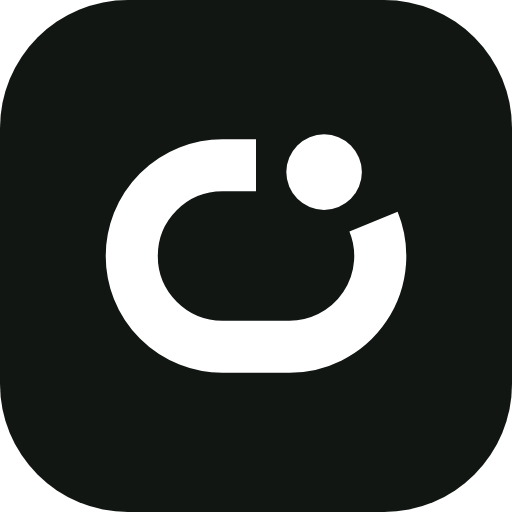

<p align="center"></p>

# Goal Race MCP

**Search races with no account. Sign in to save.**

Goal Race connects your AI assistant to a calendar of upcoming trail and ultra races, obstacle course races (Spartan, Tough Mudder, Runmageddon and more) and HYROX-style hybrid fitness races. Ask in plain words, "a 50k trail race in Spain in May" or "a HYROX near Amsterdam this spring", and get dates, waves, distances, climb, the course and how to get there. With a free Goal Race account you can also save races to your list, put a training plan on your calendar and log each session, by typing or by voice.

```
https://mcp.goalrace.com/mcp
```

A hosted remote MCP server (Streamable HTTP). Nothing to install, no token to copy. This repo holds the plugin files, one skill and the registry entry. The server itself is not open source.

## Add it

### Claude (web, desktop, mobile)

1. Settings → Connectors → **Add custom connector**.
2. Name `Goal Race`, URL `https://mcp.goalrace.com/mcp`.
3. For sign-in, choose **Sign in when needed**. Claude may pick *No sign-in* for you: change it, or Claude cannot ask you to sign in when you save a race.
4. Ask for races right away. When you save one, Claude shows a sign-in card. Sign in, click Allow, then tell Claude you have signed in.

Walkthrough with screenshots: https://www.goalrace.com/mcp

### Claude Code

```
/plugin marketplace add goalrace/goalrace-mcp
/plugin install goal-race@goalrace
```

This adds the server and the `find-a-race` skill. Run `/mcp` and pick `goal-race` to sign in when you want to save.

### ChatGPT

Settings → Apps → Advanced settings → turn on Developer mode → **Create app**. Name `Goal Race`, URL `https://mcp.goalrace.com/mcp`, authentication OAuth. ChatGPT asks you to sign in when you connect.

### Cursor

[Add to Cursor](https://cursor.com/install-mcp?name=goal-race&config=eyJ1cmwiOiJodHRwczovL21jcC5nb2FscmFjZS5jb20vbWNwIn0=), or put this in `~/.cursor/mcp.json`:

```json
{ "mcpServers": { "goal-race": { "url": "https://mcp.goalrace.com/mcp" } } }
```

### VS Code

```
code --add-mcp '{"name":"goal-race","type":"http","url":"https://mcp.goalrace.com/mcp"}'
```

### Gemini CLI

```
gemini extensions install https://github.com/goalrace/goalrace-mcp
```

## Tools

Finding races needs no account. The other tools read or change your own race list, calendar, diary and profile, with a free account.

Every tool, one line each, with what it reads or changes and when it asks first: https://www.goalrace.com/mcp/tools. That page is built from the server's own tool list, so it stays current.

## Skill

[`skills/find-a-race`](skills/find-a-race/SKILL.md) turns a request like "trail races over 50k in the Alps next summer" into the right search, and opens the race you pick.

## What it connects to

- **Network:** one address, `https://mcp.goalrace.com/mcp`, our hosted server. The plugin files hold nothing else: no scripts, no hooks, no command-line tools, nothing runs on your machine.
- **Credentials:** none to search. Saving races and using the calendar ask for a free Goal Race account through OAuth sign-in (the assistant opens our sign-in page; it never sees your password).
- **Data:** see https://www.goalrace.com/privacy. Data is stored in the EU.

## Links

- Setup guide: https://www.goalrace.com/mcp
- Docs: https://www.goalrace.com/docs
- Privacy: https://www.goalrace.com/privacy
- Official MCP registry: `com.goalrace/goal-race`
- Support: support@goalrace.com

## Licence

MIT, for the files in this repo. See [LICENSE](LICENSE).
